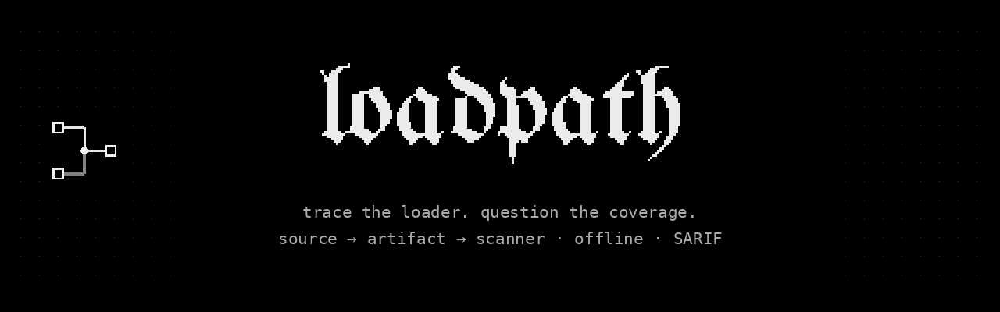
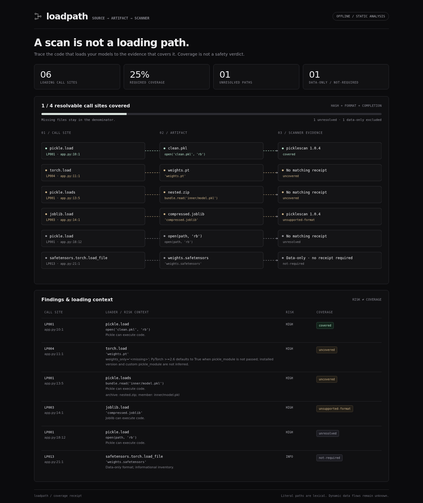
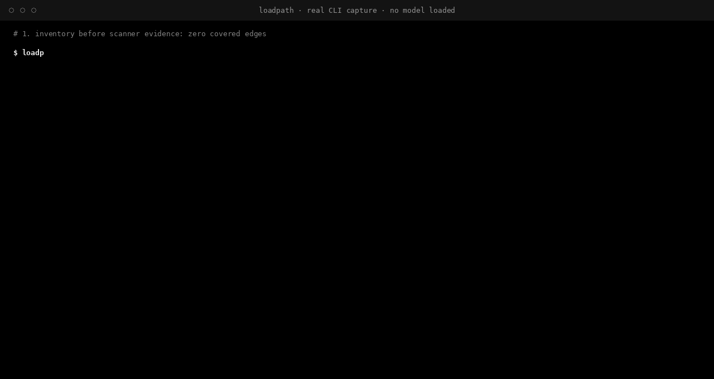
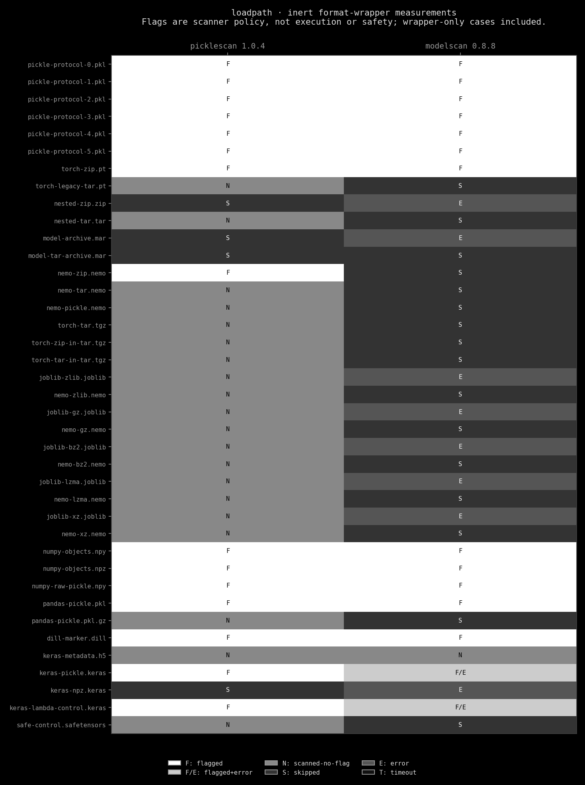
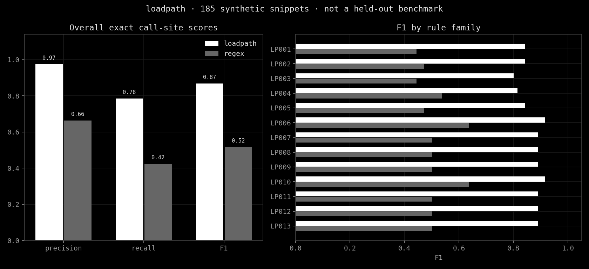
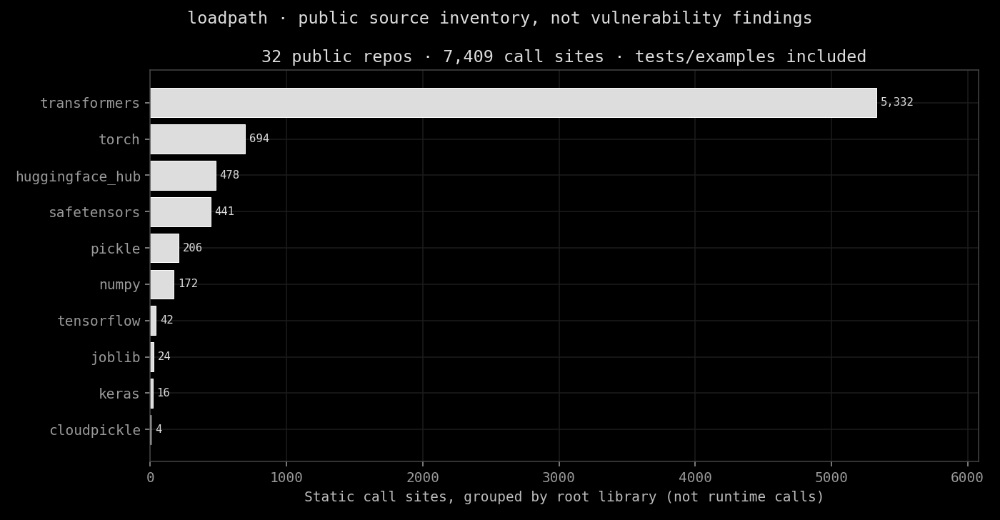

loadpath reads the code that loads your models, then asks whether the scanner covered that path. A clean scan of
`weights.pt` says little about an application that reaches a pickle through a compressed stream or nested archive.
loadpath inventories thirteen families of Python loaders without importing the source, inspects artifact headers
without deserialization, and joins each call site to hash-bound scanner receipts. Missing evidence stays visible.
The result is a terminal inventory, a self-contained coverage graph, and SARIF for code scanning. Coverage is not safety.

[](LICENSE)
[](pyproject.toml)
[](https://www.usenix.org/conference/usenixsecurity26/presentation/liu-tong)
[](https://arxiv.org/abs/2509.06703)
[](https://docs.oasis-open.org/sarif/sarif/v2.1.0/sarif-v2.1.0.html)
[](https://github.com/mmaitre314/picklescan)
[](https://github.com/protectai/modelscan)

`#model-security` `#deserialization` `#pickle` `#supply-chain` `#static-analysis` `#sarif` `#github-actions` `#devtools`



## The Problem

An application does not load a filename extension. It follows a path through library code, archives, compression and
object reconstruction. A scanner has to understand that same path to make its verdict relevant.
[*The Art of Hide and Seek*](https://www.usenix.org/conference/usenixsecurity26/presentation/liu-tong) (USENIX Security
2026) identifies **22 pickle-based loading paths across five frameworks; 19 were entirely missed by the scanners
studied**. It also reports nine exception-directed programming instances, seven bypassing all studied scanners.
[*On the (In)Security of Loading Machine Learning Models*](https://arxiv.org/html/2509.06703v3) reports **six previously
undisclosed arbitrary-code-execution vulnerabilities**, including the first officially recognized CVEs targeting
Keras safe mode. Those are the papers' findings, not results reproduced by this tool.

Three questions need separate answers:

| question | evidence | what loadpath does |
|---|---|---|
| What can this code load? | imports, call sites, risk-changing arguments | AST inventory and literal-path propagation |
| What did the scanner inspect? | scanner version, content hash, completed scan, supported format | explicit receipt edges and coverage gaps |
| Is the artifact safe? | broader analysis of code, runtime and provenance | **no safety verdict** |

## Mechanism

```text
                   inventory                inspect                 join
 Python source --> AST + import aliases --> artifact path ----+--> hash + format + completion
                   LP001–LP013             header / members  |       |
                   risk arguments          GLOBAL references |       +--> terminal / JSON
                                                             |       +--> HTML + inline SVG
 scanner receipts --> version + SHA-256 + admitted formats ----+       +--> SARIF 2.1.0
```

No source is imported. No model is loaded. Import aliases, from-imports, module chains, simple local constants,
literal `os.path.join` and `Path /` expressions are resolved. F-strings, runtime dispatch and arbitrary function
returns stay unknown. Hub downloads carry provenance context, not invented local paths. Inert inspection uses
`pickletools`, headers and bounded archive traversal: 8 MiB, depth two and 64 aggregate members.

Receipt edges are **covered**, **uncovered**, **stale-hash**, **unsupported-format**, or **unresolved**. Safetensors
sites are **not-required**: data-only and excluded from the coverage denominator. Missing literal files remain in
the denominator; unresolved sites are counted separately. [The receipt contract](docs/receipts.md) documents supported
formats and why a scanner finding and a completed scan are different things.

```text
$ loadpath rules
┏━━━━━━━┳━━━━━━━━━━━━━━━━━━━━━━━━┳━━━━━━━━━━┳━━━━━━━━━━━━━━━━━━━━━━━━━━━━━━━━━━━━━━━━━━━━━━━━━━━━━━━━━━━━━━━━━━━━━━━━━━━━━━━━━━━━┓
┃ Rule  ┃ Name                   ┃ Severity ┃ Summary                                                                            ┃
┡━━━━━━━╇━━━━━━━━━━━━━━━━━━━━━━━━╇━━━━━━━━━━╇━━━━━━━━━━━━━━━━━━━━━━━━━━━━━━━━━━━━━━━━━━━━━━━━━━━━━━━━━━━━━━━━━━━━━━━━━━━━━━━━━━━━┩
│ LP001 │ pickle-deserialization │ high     │ Pickle deserialization can execute code.                                           │
│ LP002 │ extended-pickle        │ high     │ dill and cloudpickle restore executable Python objects.                            │
│ LP003 │ joblib-load            │ high     │ Joblib may deserialize executable objects, including compressed streams.           │
│ LP004 │ torch-load             │ high     │ Unrestricted torch.load can execute code; weights_only changes the loading policy. │
│ LP005 │ torchscript-load       │ high     │ TorchScript is executable model code, not just weights.                            │
│ LP006 │ numpy-pickle           │ high     │ allow_pickle=True permits object deserialization.                                  │
│ LP007 │ pandas-pickle          │ high     │ read_pickle restores executable Python objects.                                    │
│ LP008 │ keras-load             │ medium   │ safe_mode=False and legacy HDF5 models require special review.                     │
│ LP009 │ savedmodel-load        │ high     │ SavedModel restores executable computation graphs.                                 │
│ LP010 │ remote-model-code      │ high     │ trust_remote_code=True permits repository code execution.                          │
│ LP011 │ hub-download           │ info     │ Download provenance is context, not scanner coverage.                              │
│ LP012 │ skops-load             │ medium   │ Review the trusted types passed to skops.io.load.                                  │
│ LP013 │ safetensors-load       │ info     │ Data-only safetensors loading; this is not a certificate for surrounding code.     │
└───────┴────────────────────────┴──────────┴────────────────────────────────────────────────────────────────────────────────────┘
```

## The Demo

A real CLI run against [`examples/demo_app`](examples/demo_app), an inventory-only fixture application with six
loading paths. First, none of the required paths has scanner evidence. Inspection then reveals a hand-written
`GLOBAL os.system` **reference**, without importing it or invoking it. A real picklescan receipt closes the clean
pickle edge: **0/4 → 1/4** required resolvable sites covered. The nested archive, compressed Joblib and dynamic path
remain gaps; the safetensors site needs no receipt. The last step writes the same findings as SARIF.



Re-record with `.venv/bin/python scripts/demo_gif.py`. The script saves the captured output in
[`results/demo-transcript.txt`](results/demo-transcript.txt) and verifies that the marker file's hash is unchanged.
**Do not execute the demo application or deserialize its artifacts.**

## Results

### What the scanners actually saw

**39 inert artifacts**, two real scanners, default settings, one subprocess per scanner/file. Every pickle-bearing
fixture embeds a harmless `os.getcwd` function reference, never a call; Linux serializers spell it `posix.getcwd`.
Python/C pickle loading entry points are disabled and hashes are checked before and after scanning. A flag reflects
scanner policy, not malicious behavior. **N does not mean the scanner reached the inner marker.**

F = flagged; N = scanned-no-flag; S = skipped; E = error; F/E = findings **and** errors.

| fixture | wrapper path | picklescan 1.0.4 | modelscan 0.8.8 |
|---|---|:---:|:---:|
| pickle protocols 0–5 (six files) | pkl | F | F |
| torch-zip.pt | zip→pkl | F | F |
| torch-legacy-tar.pt | tar→pkl | N | S |
| nested-zip.zip | zip→zip→pkl | S | E |
| nested-tar.tar | tar→tar→pkl | N | S |
| model-archive.mar | zip→zip→pkl | S | E |
| model-tar-archive.mar | zip→tar→pkl | S | S |
| nemo-zip.nemo | tar→zip→pkl | F | S |
| nemo-tar.nemo | tar→tar→pkl | N | S |
| nemo-pickle.nemo | tar→pkl | N | S |
| torch-tar.tgz | gz→tar→pkl | N | S |
| torch-zip-in-tar.tgz | gz→tar→zip→pkl | N | S |
| torch-tar-in-tar.tgz | gz→tar→tar→pkl | N | S |
| joblib-zlib.joblib | zlib→pkl | N | E |
| nemo-zlib.nemo | tar→zlib→pkl | N | S |
| joblib-gz.joblib | gz→pkl | N | E |
| nemo-gz.nemo | tar→gz→pkl | N | S |
| joblib-bz2.joblib | bz2→pkl | N | E |
| nemo-bz2.nemo | tar→bz2→pkl | N | S |
| joblib-lzma.joblib | lzma→pkl | N | E |
| nemo-lzma.nemo | tar→lzma→pkl | N | S |
| joblib-xz.joblib | xz→pkl | N | E |
| nemo-xz.nemo | tar→xz→pkl | N | S |
| numpy-objects.npy | npy→pkl | F | F |
| numpy-objects.npz | zip→npy→pkl | F | F |
| numpy-raw-pickle.npy | pkl | F | F |
| pandas-pickle.pkl | pkl | F | F |
| pandas-pickle.pkl.gz | gz→pkl | N | S |
| dill-marker.dill | pkl | F | F |
| keras-metadata.h5 | hdf5→opaque-pkl | N | N |
| keras-pickle.keras | zip→pkl | F | F/E |
| keras-npz.keras | zip→zip→npy→pkl | S | E |
| keras-lambda-control.keras | zip→config | F | F/E |
| safe-control.safetensors | data-only | N | S |



**These are not 39 working bypasses.** Archive/framework containers include explicitly labeled wrapper-only shapes,
not runtime-validated models. The opaque HDF5 dataset is a traversal control, not a Keras loading sink. No TensorFlow
extra was installed: ModelScan's Keras dependency errors are preserved even where it flags an inner pickle. Optional
lz4 and malformed/polyglot cases are not reproduced. See the [per-fixture validity notes](eval/scanner_coverage/manifest.json),
[complete matrix](results/scanner_coverage.md), and [raw reports](results/scanner_coverage.json).

### Source inventory versus literal grep

**185 labeled synthetic snippets**, 144 positive sites and 41 negative snippets, covering all thirteen rule families.
Both systems see the same files. A true positive requires the exact rule, canonical loader, line and column.
The regex baseline matches canonical dotted loader names followed by `(`; it cannot resolve aliases and retains
comments/strings. This is a diagnostic corpus written with knowledge of the tool, **not held-out evaluation**.

| system | TP | FP | FN | precision | recall | F1 |
|---|---:|---:|---:|---:|---:|---:|
| loadpath | 113 | 3 | 31 | 0.9741 | 0.7847 | 0.8692 |
| literal regex | 61 | 31 | 83 | 0.6630 | 0.4236 | 0.5169 |



The **31 misses and three false positives stay in** [`results/eval.json`](results/eval.json), with per-family
precision/recall/F1 and every prediction. Dynamic imports/getattr and callback assignments are missed. Local classes
named torch/joblib and a torch parameter produce false positives. The core detector was not changed to fit these cases.
Full methodology, dependencies and reproduction commands are in [`eval/README.md`](eval/README.md).

## I Scanned 32 ML Repos

A depth-one inventory of **32 public repositories**, selected in [`data/repos.txt`](data/repos.txt): Transformers,
Diffusers, Ultralytics, OpenMMLab, fairseq, nanoGPT, Stable Diffusion, NeMo and others. Source is never imported or
executed; clones are deleted after scanning. Full commit SHAs, individual findings and errors remain in
[`results/registry.json`](results/registry.json); the [repository table](results/registry.md) includes every entry.

| inventory | count / denominator | share |
|---|---:|---:|
| static call sites | 7,409 | — |
| literal path resolvable | 2,600 / 7,409 | 35.09% |
| unresolved path | 4,809 / 7,409 | 64.91% |
| torch.load, weights_only omitted | 349 / 673 | 51.86% |
| torch.load, weights_only=False | 50 / 673 | 7.43% |
| torch.load, weights_only=True | 264 / 673 | 39.23% |
| numpy.load, allow_pickle=True | 12 / 172 | 6.98% |
| Transformers from_pretrained, trust_remote_code=True | 157 / 5,332 | 2.94% |



**Inventory, not vulnerabilities.** Tests, examples and framework internals are included; this is a convenience
sample, not a prevalence estimate. A literal hub identifier can look like a path, and a resolved string need not
exist. The path ratios include all inventory sites, including data-only sites, unlike scanner coverage. Ten Torch
sites use other weights_only expressions. Torch >=2.6 commonly defaults weights_only to True; omitted arguments
are version-sensitive context, not proof of unsafe execution. All clones completed; three repositories retain four
parse errors (peft, vllm and scikit-learn). No finding was hand-corrected into a vulnerability claim.

## Install

Python 3.10+. The core needs Rich, not a model runtime or scanner installation.

```sh
pip install 'git+https://github.com/Sebastianrodaaa/loadpath.git'
loadpath scan ./src
loadpath scan ./src --receipts receipts.json --html report.html
loadpath scan ./src --json
loadpath scan ./src --sarif > loadpath.sarif
loadpath scan ./src --fail-on high
loadpath inspect ./weights.pt
loadpath rules
```

Relative literal paths use the scanned directory (or file's parent), not the shell working directory. Override with
`--artifact-base`. The default `--fail-on none` is non-blocking. Exit codes: **0** completed below threshold,
**1** severity threshold reached, **2** input/parse/inspection error. High risk and scanner coverage are independent.

For the checked-in demo, tests, measurements and artwork:

```sh
git clone https://github.com/Sebastianrodaaa/loadpath.git
cd loadpath
python3 -m venv .venv
.venv/bin/pip install -e '.[dev]'
.venv/bin/pip install -r eval/requirements.txt
make demo
.venv/bin/ruff check . && .venv/bin/pytest -q
.venv/bin/python scripts/banner.py
.venv/bin/python scripts/demo_gif.py
```

The composite action writes `loadpath.sarif`. Upload even when the severity gate fails:

```yaml
name: model-loader-inventory
on: [push, pull_request]
permissions:
  contents: read
  security-events: write
jobs:
  scan:
    runs-on: ubuntu-latest
    steps:
      - uses: actions/checkout@v4
      - uses: actions/setup-python@v5
        with:
          python-version: '3.12'
      - uses: Sebastianrodaaa/loadpath@main # Pin a full commit SHA in production.
        with:
          target: examples/demo_app
          receipts: examples/demo_app/receipts.json
          fail-on: high
      - uses: github/codeql-action/upload-sarif@v3
        if: always() && hashFiles('loadpath.sarif') != ''
        with:
          sarif_file: loadpath.sarif
```

## Limitations & Responsible Use

- **Coverage is not safety.** A completed scanner run and matching hash do not prove an artifact benign. The admitted
  format tables are deliberately conservative; an unknown scanner version does not inherit assumed support.
- **Static inventory is not execution tracing.** Wrappers, monkey patches, runtime imports, class dispatch and
  arbitrary data flow can hide loaders. Lexical names can also be lookalikes. No runtime/library version is inferred.
- **Headers are not full validation.** Inspection is bounded and does not decompress arbitrary compressed streams or
  interpret unknown pickle stack effects. A suffix or wrapper shape does not prove framework loadability.
- **Receipts are trusted input, not signed attestations.** Hashes detect post-capture drift, not a dishonest producer.
  Raw ModelScan output has no content hashes and cannot retroactively establish coverage by hashing today's file.
- **The evaluation has limits.** Synthetic templates are not natural source prevalence; inert wrapper probes are
  not the papers' exploit suites. Scanner skips, errors, missing optional dependencies and parse errors stay visible.
- **Use it on code and artifacts you are authorized to inspect.** Never deserialize the fixture pickles. The demo
  application is source-only, and GLOBAL references are evidence to read, not instructions to invoke. No scanner
  result here should be used to endorse a public repository or name its maintainers as vulnerable.

## The Name

A load path is the route from a line of Python to the object it reconstructs. A scanner verdict belongs to that
route, not just the filename at its end. The mark draws two paths converging on one evidence node; the blackletter
wordmark and monochrome presentation follow the small, inspectable-tool style of mcp-audit.

## Inspirations

- Liu et al., [*The Art of Hide and Seek*](https://www.usenix.org/conference/usenixsecurity26/presentation/liu-tong),
  USENIX Security 2026: pickle loading paths and the mismatch between framework behavior and scanner coverage.
- Digregorio et al., [*On the (In)Security of Loading Machine Learning Models*](https://arxiv.org/abs/2509.06703):
  security-oriented formats/settings and the distinction between a security narrative and implementation evidence.
- [picklescan](https://github.com/mmaitre314/picklescan) and [ModelScan](https://github.com/protectai/modelscan):
  artifact analysis that this tool contextualizes, rather than replaces.
- [mcp-audit](https://github.com/Sebastianrodaaa/mcp-audit): focused rules, reproducible data, real terminal captures,
  hash-bound evidence, monochrome plots and SARIF output.

## License

MIT, see [LICENSE](LICENSE). Copyright Sebastian Roda. The original geometric mark and bundled OFL font are credited
in [docs/art/README.md](docs/art/README.md); the font license is [docs/art/OFL.txt](docs/art/OFL.txt).
